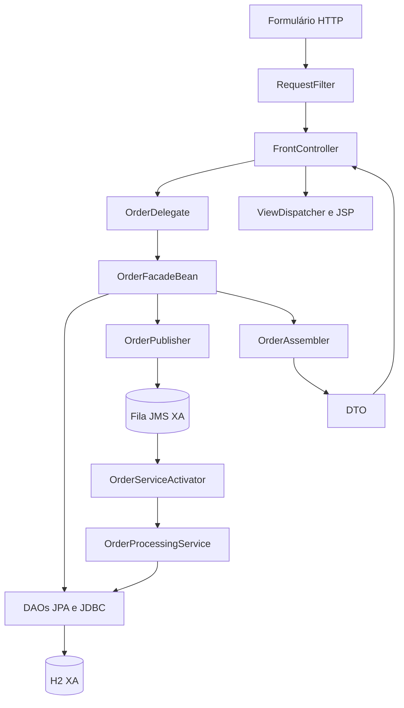

# Arquitetura e decisões

## Fluxo principal

`OrderFacadeBean.create` usa uma transação JTA que coordena o datasource H2 XA e a fábrica JMS XA fornecida pelo WildFly. Uma falha antes do commit impede que o pedido e o envio da mensagem sejam confirmados separadamente. Falhas durante a preparação/commit distribuído exigem o mecanismo de recuperação do transaction manager; a configuração de demonstração não substitui uma operação de produção com armazenamento durável, recuperação e monitoramento.

O MDB inicia uma **nova** transação. O serviço busca a raiz com `PESSIMISTIC_WRITE` e verifica o estado antes de aplicar o efeito. Duas mensagens iguais concorrentes não incrementam `processingCount` duas vezes. `@Version` também protege futuras alterações concorrentes feitas com controle otimista.

Não se promete entrega exatamente uma vez. JMS pode redeliver mensagens; o código torna o **efeito local no banco idempotente**. Se o consumidor futuramente enviar e-mails ou chamar serviços HTTP, a coluna de estado sozinha não garante idempotência externa. Use chave de idempotência no destino ou um fluxo apropriado de outbox/inbox.

## Por que não usar EJB 2.x literalmente?

O PDF usa uma geração anterior de J2EE. Implementações com home interfaces, proxies remotos por entidade, CMP/BMP e descritores extensos são relevantes para manutenção de legados, mas acrescentariam configuração histórica ao laboratório. Preservamos a intenção do catálogo e explicitamos cada adaptação:

- **Session Facade:** EJB stateless local, transações gerenciadas e métodos de caso de uso.
- **Composite Entity:** agregado JPA. Não é um Composite Entity implementado como Entity Bean EJB 2.x.
- **Business Delegate:** adaptador entre apresentação e fachada. Como o exemplo roda em um WAR e usa interface local, ele não representa uma chamada de rede real; a separação fica visível e permite trocar o adaptador.
- **Value Object:** DTO serializável; não confundir com identidade por valor de DDD. Os DTOs não implementam `equals` como requisito arquitetural.
- **Value List Handler:** variante com snapshot e cursor em sessão, não apenas `OFFSET/LIMIT`. Uma projeção limitada no banco evita materializar todas as entidades antes de criar o cache.
- **Service Locator:** rota alternativa explícita; o fluxo principal usa injeção. Não é necessário inserir lookup manual em toda classe moderna.
- **Service Activator:** MDB adapta texto JMS e chama um EJB de negócio. A regra de negócio não fica no listener.

## Transações e acesso a dados

A fachada usa `REQUIRED`. DAOs, assembler e publisher usam `MANDATORY`, para recusar chamadas fora de uma transação. O serviço chamado pelo MDB participa da transação já iniciada pelo contêiner.

O DAO não deve executar `commit`, `rollback` nem fechar o `EntityManager` injetado. O DAO JDBC fecha `Connection`, `PreparedStatement` e `ResultSet` com `try-with-resources`; fechar uma conexão gerenciada a devolve ao pool. O transaction manager controla o commit real.

JPA e JDBC usam o mesmo datasource XA `java:/jdbc/PatternsDS`. Há duas **fontes lógicas** de dados, pedido e catálogo, dentro do mesmo banco de demonstração. O assembler faz uma consulta JDBC em lote para enriquecer o DTO, sem alegar que há dois bancos independentes. O startup cria o catálogo via JPA; depois o DAO JDBC o consulta.

`@ApplicationException(rollback=true)` em `InvalidOrderException` preserva a semântica de erro de negócio e força rollback. Falhas técnicas são propagadas como exceções de sistema. O delegate traduz falhas EJB para indisponibilidade; não repete gravações automaticamente.

## Views e consultas

As JSPs ficam em `WEB-INF`. A escolha da view usa um enum com caminhos fixos. O filtro é mapeado para a entrada `/app/*`; o forward interno não precisa repetir a execução do filtro.

Service to Worker prepara os dados antes do forward. Dispatcher View usa uma JSP que chama um helper CDI durante a renderização. O helper faz cache por requisição, evitando múltiplas chamadas se EL avaliar seu getter novamente. Se a consulta do helper falhar depois de o buffer da resposta ser enviado, já pode ser tarde para trocar o status HTTP; esse é um custo da recuperação tardia dos dados. Para fluxos complexos, prefira preparação anterior à view.

O snapshot de consultas guarda no máximo 500 DTOs por sessão, com cinco registros por página. A consulta recebe limite 501 para detectar truncamento. O snapshot pode ficar desatualizado até clicar em **Atualizar consulta**; a criação de um pedido invalida o snapshot da própria sessão. Abas da mesma sessão compartilham o cursor; `synchronized` protege a consistência local, não substitui coordenação distribuída entre nós.

Para milhões de registros, adapte para paginação por chave/`keyset` e consultas com filtros e índices. Evite buscar um grafo inteiro de entidades apenas para listar resumos. `JpaOrderDao.findRecent` usa projeção agregada com ordenação estável por data e ID.

## Limites deliberados

- O projeto usa **Jakarta EE 10/WildFly 35.0.1.Final** como baseline fixada de estudo; não afirma usar a versão mais recente.
- `drop-and-create` torna os cenários reproduzíveis e destrói os dados no redeploy. Para dados reais, use migrações e desative essa opção.
- Não há autenticação ou isolamento de pedidos por usuário. CSRF, escape de saída e SQL parametrizado não implementam autorização.
- O consumidor trata duplicatas da mesma mensagem. Dois POSTs de criação podem criar dois pedidos: uma API real precisa de chave de idempotência para submissão.
- O tratamento de mensagens inválidas provoca rollback e redelivery. O servidor limita a três tentativas e usa sua DLQ padrão. Nenhum processo de reprocessamento da DLQ está implementado.
- Reinício, desastre, recuperação XA e indisponibilidade do broker não são simulados pelos testes unitários nem pelo smoke test. A documentação distingue configuração transacional de comprovação desses cenários.
- O WAR depende do Full Profile: Tomcat puro não fornece CDI/EJB/JPA/JMS/JTA para este projeto.

## Fontes técnicas

- Livro enviado: *Core J2EE Patterns: Best Practices and Design Strategies*, Deepak Alur, John Crupi e Dan Malks, capítulos 7-9. A lista de 15 padrões foi conferida no sumário e nas tabelas do capítulo 6 do PDF.
- [Jakarta EE 10: especificação oficial](https://jakarta.ee/specifications/platform/10/).
- [WildFly 35: guia oficial e perfis disponíveis](https://docs.wildfly.org/35/Getting_Started_Guide.html).
- [WildFly 35: administração, datasource e mensageria](https://docs.wildfly.org/35/Admin_Guide.html).
- [Jakarta Enterprise Beans 4.0](https://jakarta.ee/specifications/enterprise-beans/4.0/).
- [Jakarta Persistence 3.1](https://jakarta.ee/specifications/persistence/3.1/).
- [Jakarta Messaging 3.1](https://jakarta.ee/specifications/messaging/3.1/).
